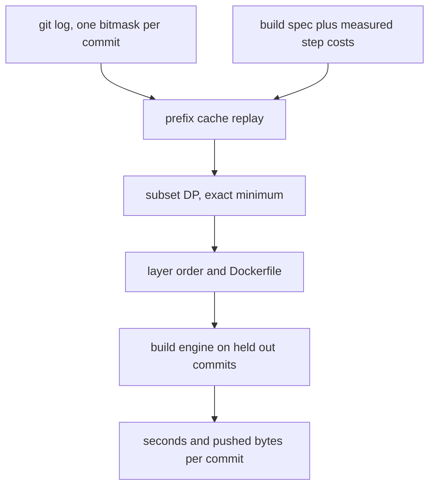
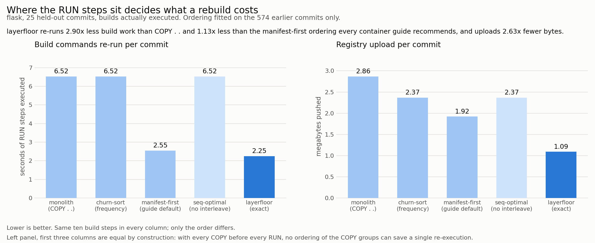

# layerfloor

Exact container image layer ordering, solved from a repository's own commit history and checked by running the builds.

## The problem

A container build cache is a prefix cache. A miss on instruction `i` forces every instruction after `i` to re-execute, and the layers those instructions produce are fresh blobs that have to be uploaded again. What a rebuild costs is therefore decided by one thing: where in the file the first changed input sits.

Every container guide gives the same one-line answer, copy the dependency manifest before the source, and then stops. Nothing tells you whether moving the documentation copy below the compile step is worth anything, because the answer depends on how often documentation actually changes in your repository, how large each layer is, and how expensive each build command is. Those are measurable facts about a repository, and nobody measures them.

Two consequences are not in the guides.

**Ordering COPY steps among themselves is worth exactly zero.** If every COPY precedes every RUN, then any commit that changes anything dirties the prefix before the first RUN is reached, so every RUN re-executes whatever the COPY order was. A COPY layer is uploaded exactly when its own content changed, which does not depend on position either. "Put rarely changing files first" buys nothing on its own. Only moving a RUN step earlier, in among the COPY groups, can save work. That is why the three leftmost columns of the chart below are identical, and it is checked in `tests/test_model.py::test_no_interleaving_means_order_cannot_help`.

**Where ordering does matter, change frequency is the wrong key.** For independent steps an exchange argument gives the exact rule: order by `cost * (1 - q) / q`, descending, where `q` is the probability the step's input changed. A 200 MB layer that changes 10 percent of the time belongs before a 2 MB layer that changes 5 percent of the time. Sorting by `q` alone gets that backwards, which `test_frequency_sort_is_not_optimal` demonstrates on a two step counterexample.

## What it does

- `layerfloor/trace.py` reduces git history to one bitmask per commit: which COPY group that commit touched.
- `layerfloor/model.py` replays the prefix cache rule over that trace and solves for the minimum cost order exactly, by dynamic programming over subsets.
- `layerfloor/engine.py` is a small build engine that really executes a spec. It has the two mechanisms that decide a rebuild's price: a prefix step cache keyed the way a container builder keys it, and a content addressed registry that charges nothing for a blob it already holds.
- `layerfloor/plan.py` is the part you would use on your own repository. Give it a JSON spec, get the order, the expected cost, and a Dockerfile.
- `demo.py` runs the whole comparison on flask and writes the chart.

## Why the exact answer is cheap

The cost of placing a step depends only on the **set** of steps before it, never on their order: a step re-executes if and only if at least one COPY group in that set changed in that commit, which is a property of the set. So the minimum is a dynamic program over subsets, `O(2^n * n * d)` for `n` steps and `d` distinct commit masks, rather than a search over `n!` permutations. Precedence, meaning a RUN step reads certain COPY groups, only prunes the state space. The ten step spec here needs 1024 states and solves in milliseconds.

`optimal_order` is checked against exhaustive permutation search on random instances in both metrics, and `ratio_rule_order` against the closed form objective, in `tests/test_model.py`.

## Architecture

FigJam board: https://www.figma.com/board/q38NbAeWjc9v0tFUxQBBCw

The diagram shows the two halves of the system: the history and the build spec feed a cost model whose minimum is found by a subset dynamic program, and the resulting order is then executed by the build engine against commits the optimiser never saw.



## Results



Ten build steps, seven COPY groups and three RUN commands, over 599 commits of [pallets/flask](https://github.com/pallets/flask). The order was fitted on the oldest 574 commits and then every one of the 25 held-out later commits was actually built, five times over, once per ordering. Nothing here is simulated: the registry column is the bytes a content addressed registry accepted, and the time column prices the re-executions the engine really performed.

| ordering | seconds of build commands re-run | MB pushed | commands re-run | cache misses observed / predicted |
| --- | --- | --- | --- | --- |
| monolith, `COPY . .` | 6.52 | 2.86 | 3.00 | 4.00 / 4.00 |
| churn-sort, by frequency | 6.52 | 2.37 | 3.00 | 7.12 / 7.12 |
| manifest-first, guide default | 2.55 | 1.92 | 2.28 | 3.56 / 3.48 |
| seq-optimal, no interleaving | 6.52 | 2.37 | 3.00 | 7.12 / 7.12 |
| **layerfloor, exact** | **2.25** | **1.09** | **1.60** | 6.88 / 6.52 |

The metric is what a rebuild costs after one commit lands. The baseline is the Dockerfile people actually write first, a single `COPY . .` followed by the build commands: it re-runs all three commands on every commit and pushes 2.86 MB. layerfloor re-runs 1.60 of them and pushes 1.09 MB, which is **2.90x less build work and 2.63x fewer bytes**. Against manifest-first, the ordering every container guide recommends, it is 1.13x on time and **1.76x on upload**.

The seconds column counts only re-executed RUN commands, priced at the median of every observed execution of that command across the whole experiment (install 5.516 s over 89 executions, compile 0.620 s over 121, bundle 0.386 s over 112). Raw stopwatch readings are in `docs/results.json` under `wall_seconds`, but they are not the comparison: the same three commands took 5.3 s per commit during one policy and 15.7 s during another purely because of machine load, which is exactly the noise a fixed price removes. Event counts and byte counts are untouched measurements.

The order it found is not one a person would write:

```
manifest -> install -> docs -> bundle -> src -> compile -> examples -> tests -> ci -> meta
```

It puts the documentation bundle **before** the source compile. Documentation changes in 25.4 percent of flask's commits and source in 39.9 percent, so bundling first shelters the cheaper step behind the rarer change: the compile and bundle pair then costs 0.69 s per commit instead of 0.75 s, and the whole order 1.69 s instead of 1.74 s. Then it parks everything no build command reads, tests, examples, CI config and changelog, at the very bottom where churn cannot reach anything.

### What the measurements confirm

- **The prefix cache model is right.** Predicted and observed cache misses agree exactly for three of the five orderings, and to within 2.3 and 5.5 percent for the other two.
- **The reproducibility asymmetry is measured, not assumed.** Building the same commit twice from scratch, all 7 COPY layers came out byte identical and all 3 RUN layers did not. That is why an unchanged COPY that is pointlessly re-executed uploads nothing while a re-executed RUN uploads its whole layer.
- **The model under-predicts bytes for the finest grained ordering** by 16 percent (0.92 MB predicted against 1.09 MB measured), and by 0.3 to 3.0 percent for the others. The cause is that the trace is built from first-parent diffs while the engine materialises real trees, so the engine sees content changes a merge hid from the trace. The chart reports the measured value, not the predicted one.
- **Granularity and ordering do different jobs.** Splitting `COPY . .` into seven groups cuts uploads 2.86 to 2.37 MB on its own, because an unchanged group keeps its blob, but it cannot save a single command re-execution. Interleaving is what does that.

### Where the gain comes from, and where it does not

The advantage over manifest-first is whatever build work happens after the source copy, so it scales with that work. `scripts/sensitivity.py` replays the same real trace under other RUN cost profiles:

| RUN cost profile | monolith | manifest-first | layerfloor | vs guide | vs monolith |
| --- | --- | --- | --- | --- | --- |
| measured demo | 5.37 s | 2.09 s | 1.58 s | 1.32x | 3.39x |
| small service | 29.70 s | 14.05 s | 10.37 s | 1.35x | 2.86x |
| typical service | 64.35 s | 29.13 s | 21.78 s | 1.34x | 2.95x |
| heavy post-build | 163.34 s | 128.13 s | 82.27 s | 1.56x | 1.99x |
| install dominates | 186.11 s | 45.24 s | 42.36 s | 1.07x | 4.39x |

If your image is one `pip install` and nothing else, manifest-first already captures almost all of the available saving and layerfloor adds 7 percent. If anything substantial runs after your sources are copied, which is the normal case for compiled assets, generated code or packaging steps, the gap is 30 to 56 percent. Those rows are model output over the real trace, with the RUN costs substituted.

## How to run it

```bash
pip install -r requirements.txt

# the full comparison: clones flask, measures step costs, runs about 140 builds,
# writes docs/before_after.png, docs/results.json and docs/Dockerfile.layerfloor
python demo.py

# quicker smoke run
python demo.py --eval 5 --fit 200

# plan an ordering for a repository without executing anything
python -m layerfloor.plan --repo .lfcache/repos/flask --spec examples/flask.json

# the cost sensitivity table above
python scripts/sensitivity.py

# tests, including the DP against exhaustive permutation search
python -m pytest tests -q
```

`demo.py` takes about 20 minutes: 8 builds to measure the step costs, then 130 more across the five orderings. It needs `git` on the PATH and one network call to fetch six wheels into `.lfcache/wheelhouse`, after which the install step runs offline. Everything it downloads or builds stays in `.lfcache/`, which is gitignored.

## Example output

`python -m layerfloor.plan --repo .lfcache/repos/flask --spec examples/flask.json`:

```
commits analysed: 568
change rate per COPY group:
  manifest       0.199      0.09 MB
  src            0.400      0.09 MB
  docs           0.255      0.47 MB
  tests          0.178      0.04 MB
  examples       0.046      0.02 MB
  meta           0.317      0.03 MB
  ci             0.255      0.00 MB

current       2.910 s and   2.481 MB per commit   manifest -> install -> src -> docs -> tests -> examples -> meta -> ci -> compile -> bundle
layerfloor    1.981 s and   1.689 MB per commit   manifest -> install -> src -> compile -> docs -> bundle -> examples -> tests -> ci -> meta
```

The `current` row is a Dockerfile that already follows the guide: manifest first, then sources, then the build commands. Moving two RUN steps up is worth 32 percent of its rebuild time and 32 percent of its upload.

`python demo.py` finishes with:

```
price per re-execution, median of all observed runs:
  bundle      0.386 s over 112 executions
  compile     0.620 s over 121 executions
  install     5.516 s over 89 executions

policy           sec/commit   MB/commit  cmds/cmt   wall sec  vs best
monolith              6.523       2.864      3.00      5.266    2.90x
churn-sort            6.523       2.368      3.00     15.686    2.90x
manifest-first        2.551       1.921      2.28      3.014    1.13x
layerfloor-seq        6.523       2.368      3.00     10.736    2.90x
layerfloor            2.251       1.091      1.60      1.825    1.00x
```

The emitted Dockerfile is `docs/Dockerfile.layerfloor`.

## What is measured and what is modelled

Measured: commit traces, layer sizes after gzip, which steps the engine had to re-execute, how long each execution took, and how many bytes a content addressed registry accepted. Reproducibility per step is measured by building the same commit twice and comparing digests.

Modelled: the invalidation rule itself, which is a container builder's documented prefix cache behaviour, implemented in `engine.py` and compared against its own predictions above. COPY layers are archived with normalised tar metadata, so a COPY layer digest is a pure function of file content; RUN layers are archived exactly as the command produced them, timestamps included, because that is what a builder commits. This is the generous assumption for the baselines, not for layerfloor.

Not covered: multi-stage builds, `--mount=type=cache`, and BuildKit's parallel execution of independent stages. The trace uses first-parent diffs and skips merge commits. The exact solver is exponential in the step count and refuses to run above 22 steps; merge COPY groups or fall back to the ratio rule above that.

## Tests

```
python -m pytest tests -q
12 passed
```

`tests/test_model.py` checks the subset DP against exhaustive permutation search over feasible orders, the ratio rule against its closed form objective on random instances, the two structural claims above, and a counterexample where frequency sorting loses. `tests/test_engine.py` builds a throwaway git repository and checks that rebuilding the same commit is a total cache hit, that a RUN step placed after a churning COPY is invalidated by it while the same step placed before it is not, and that two commits with identical content for a group share one layer digest.
